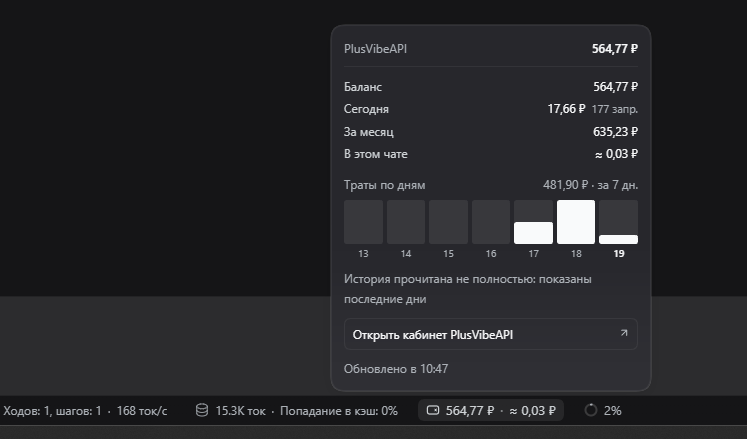

# dsh-plusvibe-balance

**English** | [Русский](README.ru.md)

A DeepSeek Harness plugin that shows your [PlusVibeAPI](https://plusvibeapi.ru) balance
right under the message box, next to the context meter — and a card of what you have
spent: today, this month, this chat, and the last days as a chart.

## Install

Requires DeepSeek Harness `0.2.0-rc.2` or newer. Run the line for your app, then restart
that profile — the plugin appears under **Plugins** as `dsh-plusvibe-balance`, switched on.

**Web profile** (`dsh web`, or a browser profile you boot yourself):

```sh
dsh plugin --profile web add dsh-plusvibe-balance
```

**Desktop app:**

```sh
dsh plugin --profile desktop add dsh-plusvibe-balance
```

The package is on npm as
[`dsh-plusvibe-balance`](https://www.npmjs.com/package/dsh-plusvibe-balance), which is the
recommended route.

### From the repository

If the registry copy lags behind `main`, or you want a commit the registry does not carry,
install the Git address — there is no build step, so pnpm reads the repository as it is:

```sh
dsh plugin --profile web add github:ilyshkafox/dsh-plusvibe-balance
dsh plugin --profile desktop add github:ilyshkafox/dsh-plusvibe-balance
```

---

## What you get



The composer's bottom row normally carries two readings: turns/steps with output speed,
and the token total with the cache hit rate. This plugin adds a third, at the right:

```
                                     ⌁ 1 234,56 ₽ · ≈ 0,42 ₽    ● 12%   3↑ 47→ 58 t/s
                                    └─ balance ─┘ └ this chat ┘ └ context ┘ └─ shipped ─┘
```

- **The reading appears only when the selected model routes through PlusVibeAPI**
  (`plusvibeapi.ru` or `gw.plusvibeapi.ru`). Pick a model from another provider and it
  disappears — no half-truths about someone else's account.
- **Click it** for a card: remaining balance, today's spend and request count, this
  month's spend, an estimate for this chat, a bar chart of spend by weekday, and a link
  to the account page.
- **Colour reacts to the balance**: normal, warning below 100 ₽, error below 10 ₽, so an
  almost-empty account is visible without opening anything.
- **Refreshes on its own** every minute while the balance is visible.
- **The refresh button** in the card's top-right corner re-reads the balance and the
  chart at once, without waiting out the minute and without accepting a cached answer;
  its icon spins while the request is in flight. It is also the way out of a
  "fetch failed" card: once the network is back, one click re-reads it instead of
  leaving the error there until the page reloads.

## Why the key never leaves the machine

The browser half cannot call PlusVibeAPI directly: that would put your `sk-pv-…` key in
the page. So the plugin is split in two:

| Half | Runs in | Does |
|---|---|---|
| Host | the DSH process | reads the key from the provider's `apiKeyEnv` (or an inline `apiKey`), calls the API, caches the answers |
| Browser | the page | renders the reading and the card, talks only to four same-origin routes |

Routes the Host registers: `/plusvibe/providers`, `/plusvibe/balance`, `/plusvibe/daily`,
`/plusvibe/rates`. They answer JSON, refuse a request another origin started
(`Sec-Fetch-Site`), and are removed when the bundle is turned off.

## API calls it makes

All with **your** key, all read-only, all through the Host:

| Endpoint | Used for |
|---|---|
| `GET /v1/balance` | the remaining balance |
| `GET /api/key/usage` | today's and this month's spend, requests today |
| `GET /v1/pricing` | per-million token rates of the current model |
| `GET /v1/generations` | the per-day history behind the chart |

Caching: balance 20 s, usage 30 s, price list 30 min, history 1 min. Several open
sessions share one request instead of stampeding the provider. The card's refresh
button sends `refresh=1` to the balance and history routes, which skips that cache —
otherwise the button would hand back the same answer for another 20 seconds.

## How "this chat" is counted

PlusVibeAPI does not report spend per chat — its history has request ids, not DSH
sessions. So this figure is **an estimate**, and it is labelled with `≈`:

```
(uncached_input × rate_in  +  cache_read × rate_cache_read
 + cache_write × rate_cache_write  +  output × rate_out) / 1 000 000
```

Tokens come from the session's own durable usage; the rates come from
`GET /v1/pricing`, the variant the catalog marks `isDefault`. That is the route an
unpinned request takes.

Where it can differ from the invoice:

- the gateway may route to another variant with different rates;
- the provider's minimum charge per request is not modelled;
- switching models mid-chat prices the whole chat at the current model's rates;
- provider-side rounding.

Today, this month and the per-day chart are **not** estimates: those are the sums the
provider actually charged (`cost_rub`).

## Limitations

- Web only. The pill lives in the composer dock, which only the Web/Desktop surface has.
- One provider at a time: the reading follows the model the session currently routes to.
- Balance for a model routed through a different provider is never shown.
- No spending limit, no alert: it reports, it does not police.
- The per-day chart is built from the request history: the provider has no per-day
  totals. So the window is read from the newest record back to its start, at most
  `dailyMaxPages` × 100 records per pass; what it read is remembered, and a refresh
  asks only for the new records, one page usually. A pass that runs out of budget
  continues on the next refresh. Until the window is covered, the card says the
  history was read only partly.
- A day in the chart is a calendar day on the machine running DSH, not a UTC day. The
  boundary goes through the calendar, so a daylight-saving change inside the window
  cannot shift a day.
- "Today" comes from the same chart, so the two never disagree. The provider's own
  `spendTodayRub` counts a UTC day, which starts later than the local one, so its
  "today" is smaller.

## Trademarks and use of the mark

The PlusVibeAPI mark appears in this repository only where it identifies the service the
plugin talks to, and nowhere else. Three files carry it, all taken from the mark
published on [plusvibeapi.ru](https://plusvibeapi.ru) and kept unchanged:

| File | What it is |
|---|---|
| `icon.svg` | the bolt as vector artwork, same path and same brand yellow — the plugin's icon inside DSH |
| `assets/icon.png` | the square mark as published, used only as the storefront tile in plugin directories |
| `docs/preview.svg` | the drawing on the plugin details page, which redraws the same bolt |

**Unofficial.** This plugin is not affiliated with, sponsored by, or endorsed by
PlusVibeAPI, and it is not an official client of theirs.

**Non-commercial.** The author receives nothing from it: no sales, no subscriptions, no
paid tiers, no donations, no advertising, no affiliate or referral payments, no paid
support. It is published free of charge as open source, for anyone to use.

PlusVibeAPI and its logo belong to their owner; this project claims no rights to them.
**If the rightsholder asks for the mark to be removed or replaced — for any reason, with
no justification needed — it will be removed in the next release**, and the package can
be republished without it the same day. Those three files are the only ones that carry
the mark, and nothing else in the package refers to them, so replacing them with any
other glyph is a three-file change that touches no behaviour: `icon.svg` and
`assets/icon.png` are static assets, and `docs/preview.svg` is a document, not code.

## License

[MIT](LICENSE) — use it, change it, publish your own version.

The license covers this plugin's code only. It grants no rights to the
PlusVibeAPI name or logo, and it comes with no warranty: if the numbers here
disagree with your invoice, the invoice wins.

## Contributing

Bug reports and small fixes are welcome — see [CONTRIBUTING.md](CONTRIBUTING.md).
Changes are listed in [CHANGELOG.md](CHANGELOG.md).

## Contact

Written and maintained by **ilyshkafox** — <ilyshkafox@mail.ru>.

| What | Where |
|---|---|
| Bugs, questions, ideas | [open an issue](https://github.com/ilyshkafox/dsh-plusvibe-balance/issues) |
| A request from the rightsholder about the mark | email, and it is honoured in the next release |
| A security problem | email, with `security` in the subject |

Email is fine for anything that does not fit an issue. It is a personal mailbox, so
please put the project name in the subject; an unsolicited attachment is not opened.