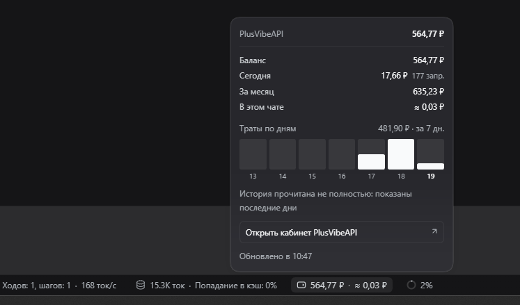

# dsh-plusvibe-balance

[English](README.md) | **Русский**

Плагин для DeepSeek Harness: показывает остаток баланса [PlusVibeAPI](https://plusvibeapi.ru)
прямо под полем ввода, рядом с индикатором контекста, и карточку трат — за сегодня, за
месяц, за этот чат и график по дням.

## Установка

Нужен DeepSeek Harness `0.2.0-rc.2` или новее. Выполните строку для своего приложения и
перезапустите профиль — плагин появится в **Plugins** как `dsh-plusvibe-balance` уже
включённым.

**Веб-профиль** (`dsh web` или свой браузерный профиль):

```sh
dsh plugin --profile web add dsh-plusvibe-balance
```

**Приложение Desktop:**

```sh
dsh plugin --profile desktop add dsh-plusvibe-balance
```

Пакет есть на npm:
[`dsh-plusvibe-balance`](https://www.npmjs.com/package/dsh-plusvibe-balance) — это
рекомендуемый способ.

### Из репозитория

Если копия в реестре отстаёт от `main` или нужен коммит, которого в реестре нет,
укажите адрес Git — шага сборки у пакета нет, pnpm берёт репозиторий как есть:

```sh
dsh plugin --profile web add github:ilyshkafox/dsh-plusvibe-balance
dsh plugin --profile desktop add github:ilyshkafox/dsh-plusvibe-balance
```

---

## Что вы увидите



Нижняя строка композера обычно несёт два показания: ходы/шаги со скоростью вывода и
сумму токенов с попаданием в кэш. Плагин добавляет третье, справа:

```
                                     ⌁ 1 234,56 ₽ · ≈ 0,42 ₽    ● 12%   3↑ 47→ 58 t/s
                                    └─ баланс ───┘ └ этот чат ┘ └ контекст ┘ └── штатное ──┘
```

- **Показание появляется только когда выбранная модель идёт через PlusVibeAPI**
  (`plusvibeapi.ru` или `gw.plusvibeapi.ru`). Выбрали модель другого провайдера —
  индикатор исчез, чтобы не показывать чужие цифры.
- **Клик** открывает карточку: остаток, траты за сегодня и число запросов, траты за
  месяц, оценка по этому чату, график трат по дням недели и ссылка в личный кабинет.
- **Цвет зависит от остатка**: обычный, предупреждение ниже 100 ₽, ошибка ниже 10 ₽ —
  почти пустой счёт видно, не открывая карточку.
- **Обновляется само** раз в минуту, пока баланс на экране.
- **Кнопка обновления** в правом верхнем углу карточки перечитывает баланс и график
  сразу, не дожидаясь минуты и не отдавая закэшированный ответ; пока идёт запрос,
  значок вращается. Ей же лечится «fetch failed» — после починки сети нажмите её, и
  карточка перечитается, а не останется с ошибкой до перезагрузки страницы.

## Почему ключ не покидает машину

Браузерная часть не может звать PlusVibeAPI напрямую: тогда ключ `sk-pv-…` попал бы на
страницу. Поэтому плагин разделён на две половины:

| Половина | Где работает | Что делает |
|---|---|---|
| Host | в процессе DSH | читает ключ из `apiKeyEnv` провайдера (или из `apiKey`), зовёт API, кэширует ответы |
| Браузер | на странице | рисует показание и карточку, общается только с четырьмя своими маршрутами |

Маршруты, которые регистрирует Host: `/plusvibe/providers`, `/plusvibe/balance`,
`/plusvibe/daily`, `/plusvibe/rates`. Они отдают JSON, отклоняют запрос, начатый другим
origin (`Sec-Fetch-Site`), и снимаются при выключении бандла.

## Какие запросы он делает

Все — **вашим** ключом, все только на чтение, все через Host:

| Эндпоинт | Зачем |
|---|---|
| `GET /v1/balance` | остаток баланса |
| `GET /api/key/usage` | траты за сегодня и за месяц, число запросов |
| `GET /v1/pricing` | ставки за миллион токенов для текущей модели |
| `GET /v1/generations` | история по дням для графика |

Кэш: баланс 20 с, расход 30 с, прайс 30 мин, история 1 мин. Несколько открытых сессий
делят один запрос, а не бомбят провайдера параллельно. Кнопка обновления в карточке
передаёт `refresh=1` маршрутам баланса и истории и пропускает этот кэш — иначе кнопка
возвращала бы то же самое ещё 20 секунд.

## Как считается «в этом чате»

PlusVibeAPI не отдаёт траты по чату: в истории есть идентификаторы запросов, но нет
сессий DSH. Поэтому эта цифра — **оценка**, и она помечена знаком `≈`:

```
(вход_без_кэша × ставка_вход  +  чтение_кэша × ставка_кэш
 + запись_кэша × ставка_запись  +  выход × ставка_выход) / 1 000 000
```

Токены берутся из собственного durable-учёта сессии, ставки — из `GET /v1/pricing`, тот
вариант, который каталог помечает `isDefault`. Именно на него уходит запрос без явного
маршрута.

Где оценка может разойтись со счётом:

- шлюз может отправить запрос на другой вариант с другими ставками;
- минимальное списание за запрос не учитывается;
- при смене модели в середине чата весь чат считается по ставкам текущей модели;
- округление на стороне провайдера.

А вот «сегодня», «за месяц» и график по дням — **не** оценка: это суммы, которые
провайдер фактически списал (`cost_rub`).

## Ограничения

- Только Web. Плагин живёт в доке композера, а он есть лишь у Web/Desktop.
- Один провайдер за раз: показание следует за моделью, на которую сейчас маршрутизируется
  сессия.
- Баланс для модели другого провайдера не показывается никогда.
- Нет лимитов и оповещений: плагин показывает, но не следит.
- График по дням собирается из истории запросов: готовых сумм по дням провайдер не
  отдаёт. Поэтому окно прочитывается от свежих записей к старым, не больше
  `dailyMaxPages` × 100 записей за проход; прочитанное запоминается, и обновление
  дозапрашивает только новые записи, обычно одну страницу. Проход, упёршийся в лимит,
  продолжается со следующего обновления. Пока окно не покрыто, карточка пишет, что
  история прочитана не полностью.
- Сутки в графике — календарные сутки той машины, где запущен DSH, а не UTC. Граница
  считается по календарю, поэтому переход на летнее время внутри окна не сдвигает день.
- «Сегодня» в карточке берётся из того же графика, чтобы цифры не спорили друг с
  другом. Счётчик `spendTodayRub` у провайдера считает сутки по UTC и в Москве
  начинается на три часа позже, поэтому его «сегодня» меньше.

## Товарные знаки

Знак PlusVibeAPI встречается в репозитории только там, где обозначает сервис, с которым
работает плагин, и больше нигде. Его несут три файла, все — из знака, опубликованного на
[plusvibeapi.ru](https://plusvibeapi.ru), и все без изменений:

| Файл | Что это |
|---|---|
| `icon.svg` | молния в векторе, тот же контур и тот же брендовый жёлтый — иконка плагина внутри DSH |
| `assets/icon.png` | квадратный знак в том виде, как он опубликован; только плитка в каталогах плагинов |
| `docs/preview.svg` | рисунок на странице подробностей плагина, где та же молния нарисована заново |

**Неофициальный.** Плагин не связан с PlusVibeAPI, не спонсируется и не одобрен ими,
это не их официальный клиент.

**Некоммерческий.** Автор не получает с него ничего: ни продаж, ни подписок, ни платных
версий, ни донатов, ни рекламы, ни партнёрских или реферальных выплат, ни платной
поддержки. Плагин распространяется бесплатно, как открытый код, и пользоваться им может
любой.

PlusVibeAPI и его логотип принадлежат их владельцу, и этот проект не претендует на
права на них. **Если правообладатель попросит убрать или заменить знак — по любой
причине, без объяснений — это будет сделано в следующем же релизе**, а пакет можно
перевыпустить без него в тот же день. Эти три файла — единственные, что несут знак, и
больше в пакете на них ничего не ссылается, поэтому замена на любой другой глиф —
правка трёх файлов, которая не затрагивает поведение: `icon.svg` и `assets/icon.png` —
статические ресурсы, а `docs/preview.svg` — документ, а не код.

## Лицензия

[MIT](LICENSE) — пользуйтесь, меняйте, публикуйте свою версию.

Лицензия покрывает только код плагина. Она не даёт прав на название и логотип
PlusVibeAPI и не содержит гарантий: если цифры здесь разойдутся со счётом,
прав счёт.

## Участие

Сообщения об ошибках и небольшие правки приветствуются — см.
[CONTRIBUTING.md](CONTRIBUTING.md). Изменения — в
[CHANGELOG.md](CHANGELOG.md).

## Контакты

Автор и сопровождающий — **ilyshkafox**, <ilyshkafox@mail.ru>.

| Что | Куда |
|---|---|
| Ошибки, вопросы, идеи | [issue в репозитории](https://github.com/ilyshkafox/dsh-plusvibe-balance/issues) |
| Обращение правообладателя по поводу знака | письмо на почту; будет выполнено в следующем релизе |
| Проблема безопасности | письмо на почту с `security` в теме |

Почта — для всего, что не помещается в issue. Это личный ящик, поэтому пишите
название проекта в теме; вложения от незнакомых отправителей не открываются.